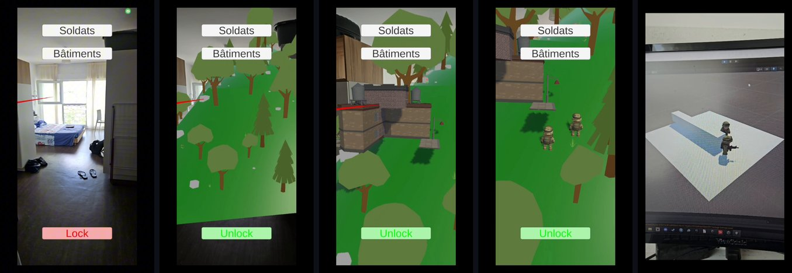

<picture><source media="(prefers-color-scheme: dark)" srcset="https://raw.githubusercontent.com/ThibPltt/ThibPltt/main/assets/repos/ARmageddon-dark.svg"><source media="(prefers-color-scheme: light)" srcset="https://raw.githubusercontent.com/ThibPltt/ThibPltt/main/assets/repos/ARmageddon-light.svg"></picture>

# ARmageddon

Battle sandbox in augmented reality: shape the terrain on your own floor, then deploy troops and buildings on it.

| At a glance | |
|---|---|
| **Dates** | 2024 – 2025 |
| **Context** | augmented reality · solo project · ENSIM |
| **Technologies** | AR · Unity · C# · AR Foundation |
| **Video** | [Demo, 1 min 25](Documentation/2025_AR_PLATET.mp4) |
| **Documents** | [Report](Documentation/2025_AR_PLATET_rapport.pdf) · [Slides](Documentation/2025_AR_PLATET_presentation.pdf) (PDF, in French) |
| **Play it** | [Android APK](https://github.com/ThibPltt/ARmageddon/raw/main/apk_build/Build.apk) (ARCore device) |

## Problem

Recreate dynamic battlefields in the user's own room: generate a terrain on the real floor or table, reshape its relief, place armies and watch the battlefield from every angle.

## Role

Solo project, ENSIM 4th year (Interaction Personnes-Systèmes), supervised by E. Blanchard and C. Coupry.

## Decisions

- Generate the terrain from the planes detected by AR Foundation, so that it sits on the real floor or table.
- Separate editing from play: the relief can be raised or lowered until the terrain is locked; nature (trees, rocks) appears once it is locked.
- Place units and buildings through an interactive interface, anywhere on the terrain.
- Use Unity's NavMesh for the units' movements.

## Result

A working AR sandbox on Android: generated terrain, relief editing, lock, nature, buildings and soldiers. Moving and fighting units were not achieved: NavMesh does not recognise a procedural terrain modified in real time in AR as a walkable surface, despite mesh colliders, baking and scripts. A separate test scene shows two soldiers detecting each other and closing in.

## Features

✅ Terrain generated dynamically from the detected real environment  
✅ Relief editing: raise or lower the ground  
✅ Lock / unlock terrain editing; nature appears once the terrain is locked  
✅ Placement of buildings and soldiers anywhere on the terrain  
✅ Interactive UI to place units and edit the terrain  
⚠️ Autonomous movement of units (pathfinding), automatic combat, historical battles: planned, not implemented

## Run it

- **On a phone:** download [`apk_build/Build.apk`](https://github.com/ThibPltt/ARmageddon/raw/main/apk_build/Build.apk) and install it on an Android device that supports ARCore (allow installs from unknown sources).
- **From the source:** open the project with Unity **2022.3.50f1** (also runs with 2022.3.37f1), switch the platform to Android in *File › Build Settings*, then *Build And Run* with the phone connected over USB (developer mode enabled). AR Foundation 5.1 with ARCore, XR Interaction Toolkit, UI Toolkit.

## Roadmap

- Real automated battles between units
- Pathfinding on dynamic terrain
- Roads, rivers, lakes and other strategic elements
- Local or online multiplayer

**Author:** Thibaut Platet · ENSIM, 2025 · [thibautplatet.com](https://thibautplatet.com/en/)
