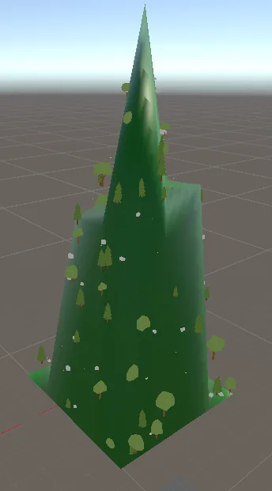
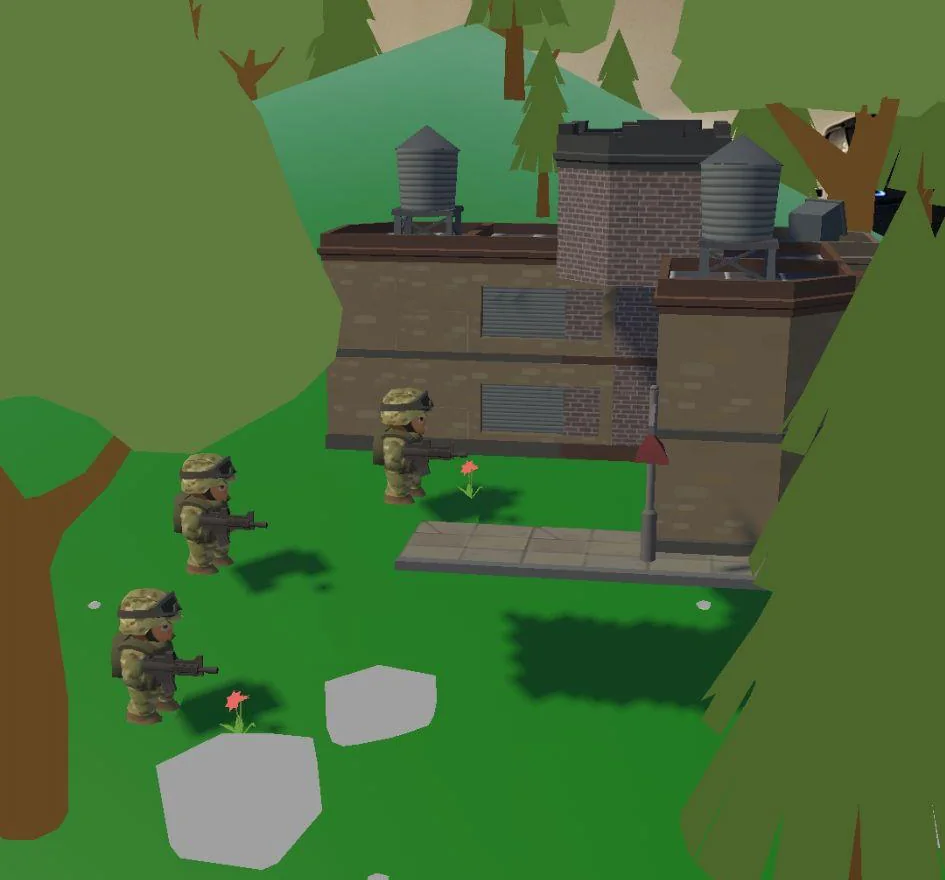
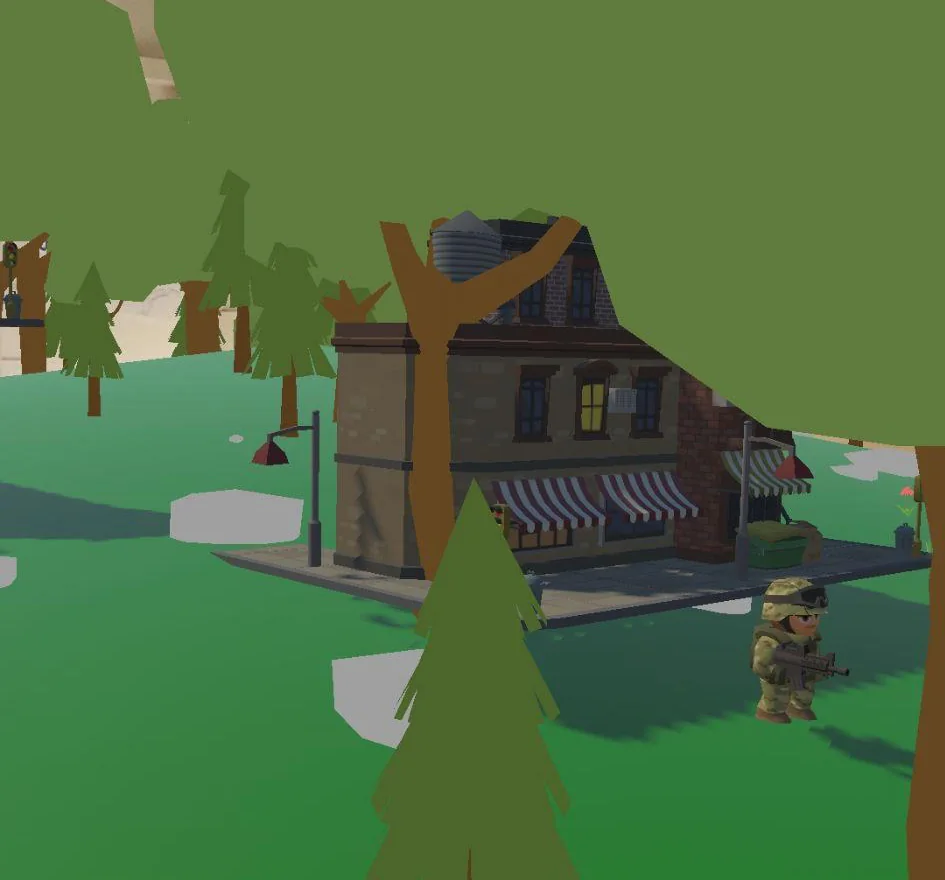

<a href="https://thibautplatet.com/en/projects/armageddon.html"><picture><source media="(prefers-color-scheme: dark)" srcset="https://raw.githubusercontent.com/ThibPltt/ThibPltt/main/assets/repos/ARmageddon-dark.svg"><source media="(prefers-color-scheme: light)" srcset="https://raw.githubusercontent.com/ThibPltt/ThibPltt/main/assets/repos/ARmageddon-light.svg"></picture></a>

# ARmageddon

Battlefield simulation in augmented reality on an Android phone, built with Unity.

| At a glance | |
|---|---|
| **Dates** | 2025 |
| **Context** | augmented reality · solo project · ENSIM |
| **Technologies** | AR · Unity · C# · AR Foundation · Android |
| **Play it** | [v0.1 Android APK](https://github.com/ThibPltt/ARmageddon/releases/latest) (ARCore device) |
| **Video** | [Demo on YouTube](https://www.youtube.com/watch?v=-H1b89DvUtM) |
| **Case study** | [thibautplatet.com/en/projects/armageddon.html](https://thibautplatet.com/en/projects/armageddon.html) |
| **Documents** | [Report](Documentation/2025_AR_PLATET_rapport.pdf) · [Slides](Documentation/2025_AR_PLATET_presentation.pdf) (PDF, in French) |

## Problem

Make a miniature battlefield appear in the room, and be able to walk around it to watch it from every angle.

## Role

Solo project, ENSIM 4th year (Interaction Personnes-Systèmes), supervised by E. Blanchard and C. Coupry.

## Decisions

A terrain generated procedurally on the detected floor; a relief raised or lowered with two fingers; a lock on the terrain before placing soldiers and buildings on it.

## Result

A prototype that runs on a phone, shown on video: terrain, nature, soldiers and buildings placed with a tap. Soldier movement is prototyped in a test scene. Improvements are planned.

## The idea

ARmageddon makes a miniature battlefield appear in the room you are in. The phone detects the floor: a hilly terrain rises from it, gets covered with trees, rocks and flowers, then takes soldiers and buildings, in a cartoon style.

The player walks around the scene and watches it from every angle. The starting idea: re-enact battles while seeing the whole battlefield, and show what augmented reality makes possible.

## Build and result

A prototype built alone in about fifteen hours, between lab sessions and personal work, with Unity 2022.3 and C#, AR Foundation 5.1 and ARCore.

- A terrain generated on the detected floor, with an adjustable relief.
- A lock on the terrain, which can be lifted afterwards.
- Soldiers and buildings placed anywhere, with a tap.
- A three-button interface: Soldats (soldiers), Bâtiments (buildings) and Lock.

Built in increments: first a working, interactive terrain, then the soldiers and buildings, finally the interface and the nature.

## From the floor of the room to the terrain

- **Detect the floor.** AR Foundation finds the flat surfaces of the room; the app keeps the lowest one and hides the others.
- **Generate the relief.** The terrain mesh is computed with Perlin noise over five octaves; its height falls to zero at the edges.
- **Raise it.** Centred on the detected surface, the terrain rises from the floor.
- **Plant the scenery.** Trees, rocks and flowers are scattered at random, each one set at the height of the relief.
- **Sculpt.** Two fingers dragged up or down raise or lower the relief; the scenery follows the new height.
- **Lock.** The Lock button freezes the terrain; it then reads Unlock, to resume editing.

<table>
<tr>
<td width="40%" align="center"></td>
<td width="60%" align="center"></td>
</tr>
<tr>
<td align="center">The procedural terrain in the Unity editor, with a very pronounced relief.</td>
<td align="center">The terrain in augmented reality, set on the floor of the room.</td>
</tr>
</table>

## Soldiers and buildings

The Soldats and Bâtiments buttons switch on a placement mode: at the next tap, a ray is cast from the screen, and the object appears where that ray meets the terrain.

<table>
<tr>
<td width="50%"></td>
<td width="50%"></td>
</tr>
<tr>
<td align="center">Three soldiers and a building placed on the terrain.</td>
<td align="center">Another building, seen up close.</td>
</tr>
</table>

## Soldier navigation

Soldiers are meant to seek each other out and fight. This behaviour is prototyped in a test scene, with Unity’s navigation system (NavMesh): each soldier spots the nearest one within a given radius, reaches it by going around obstacles, and both disappear on contact. On the generated terrain, NavMesh does not yet treat the procedural mesh, reshaped in real time, as a walkable surface: that is the next step.

The test scene: the two soldiers go around the wall to meet.

## In the project

| Script (`Assets/Scripts/`) | Role |
|---|---|
| `ARPlacement.cs` | Plane detection with AR Foundation, keeps the lowest surface and hides the others. |
| `ProceduralTerrain.cs` | Terrain mesh from Perlin noise (five octaves), edge falloff, rise animation, scattered scenery. |
| `TerrainHeightController.cs` | Two-finger gesture to raise or lower the relief. |
| `Locker.cs` | Lock / Unlock button for terrain editing. |
| `SpawnSoldier.cs`, `SpawnBuilding.cs` | Placement mode: a ray cast from the tap onto the terrain layer. |
| `SoldierPathFInding.cs` | NavMesh agent that reaches the nearest soldier in range (test scene). |

Scenes: `Assets/Scenes/MainScene.unity` (the game) and `Assets/Scenes/Test.unity` (navigation test).

## Run it

- **On a phone:** download `ARmageddon_v0.1.apk` from the [latest release](https://github.com/ThibPltt/ARmageddon/releases/latest) and install it on an Android device that supports ARCore (allow installs from unknown sources).
- **From the source:** open the project with Unity **2022.3.50f1** (also runs with 2022.3.37f1), switch the platform to Android in *File › Build Settings*, then *Build And Run* with the phone connected over USB (developer mode enabled). AR Foundation 5.1 with ARCore, XR Interaction Toolkit, UI Toolkit.

## Next steps

Several teams of soldiers, water and roads, a bombing system.

## Credits

Solo project by Thibaut Platet, ENSIM, 2025. Trees, rocks, soldiers and buildings: 3D models from asset packs imported into Unity, under their own licences. More on [thibautplatet.com](https://thibautplatet.com/en/projects/armageddon.html).

## Licence

The code and the original content of this repository (scripts, scenes, prefabs, own models, textures and sounds) are released under the [MIT licence](LICENSE).

### Third-party assets

The packages below are **not included** in this repository and are not covered by the MIT licence: they stay under their publishers’ terms (mostly the [Unity Asset Store EULA](https://unity.com/legal/as-terms)). To open the full project, get them from their store page and import them into the folder shown; Unity keeps their GUIDs, so the scenes find them again. The playable builds are in the [Releases](https://github.com/ThibPltt/ARmageddon/releases/latest).

| Folder | Asset | Source | Licence |
|---|---|---|---|
| `Assets/Soldiers` | [Toony Tiny People Demo](https://assetstore.unity.com/packages/slug/113188) — Polygon Blacksmith | Unity Asset Store | Asset Store EULA |
| `Assets/Buildings` | [Toony Tiny City Demo](https://assetstore.unity.com/packages/slug/176087), with the Toony Tiny Citizens demo | Unity Asset Store | Asset Store EULA |
| `Assets/Terrain` | [Low-Poly Simple Nature Pack](https://assetstore.unity.com/packages/slug/162153) — Just Create | Unity Asset Store | Asset Store EULA |

Included in the repository under their own licences:

- `Assets/TextMesh Pro`: TextMesh Pro, a Unity package under the Unity Companion Licence.

🇫🇷 En bref

Simulation de champ de bataille en réalité augmentée sur téléphone Android, sous Unity : faire apparaître un champ de bataille miniature dans la pièce, et pouvoir en faire le tour pour l’observer sous tous les angles. Projet réalisé seul à l’ENSIM (2025). APK Android dans les [Releases](https://github.com/ThibPltt/ARmageddon/releases/latest). Fiche complète sur [thibautplatet.com](https://thibautplatet.com/projets/armageddon.html).

