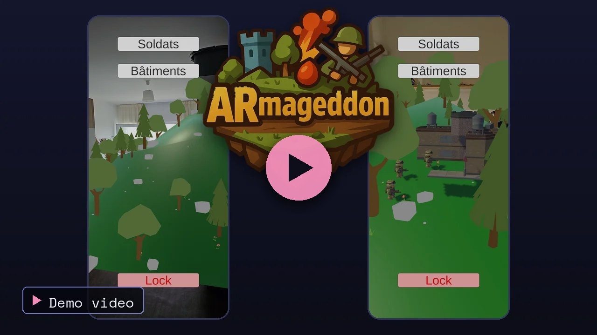
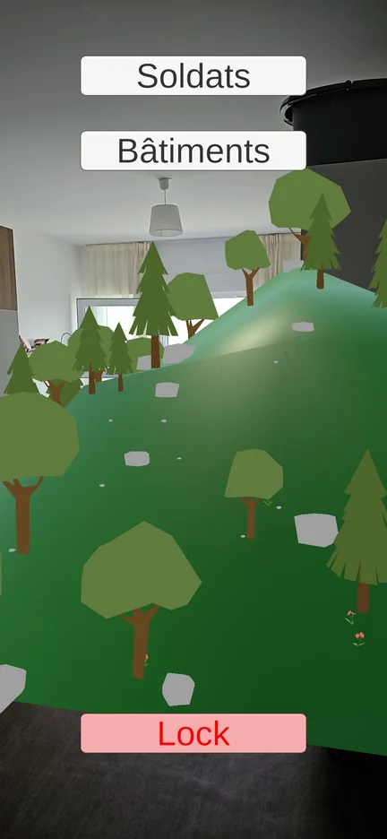
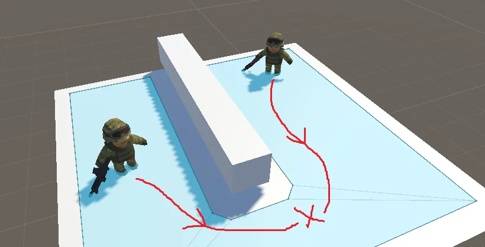

<a href="https://thibautplatet.com/en/projects/armageddon.html"><picture><source media="(prefers-color-scheme: dark)" srcset="https://raw.githubusercontent.com/ThibPltt/ThibPltt/main/assets/repos/ARmageddon-dark.svg"><source media="(prefers-color-scheme: light)" srcset="https://raw.githubusercontent.com/ThibPltt/ThibPltt/main/assets/repos/ARmageddon-light.svg"></picture></a>

# ARmageddon

Battlefield simulation in augmented reality on an Android phone, built with Unity.

| At a glance | |
|---|---|
| **Dates** | 2025 (ENSIM prototype) · 2026 (v1.0) |
| **Context** | augmented reality · solo project · ENSIM |
| **Technologies** | AR · Unity · C# · AR Foundation · Android |
| **Play it** | [v1.0 Android APK](https://github.com/ThibPltt/ARmageddon/releases/latest) (ARCore device) |
| **Video** | [Demo on YouTube](https://www.youtube.com/watch?v=-H1b89DvUtM) (v0.2 prototype) |
| **Case study** | [thibautplatet.com/en/projects/armageddon.html](https://thibautplatet.com/en/projects/armageddon.html) |
| **Documents** | [Report](Documentation/2025_AR_PLATET_rapport.pdf) · [Slides](Documentation/2025_AR_PLATET_presentation.pdf) (PDF, in French, about the prototype) |

## Problem

Make a miniature battlefield appear in the room, and be able to walk around it to watch it from every angle.

## Role

Solo project, ENSIM 4th year (Interaction Personnes-Systèmes), supervised by E. Blanchard and C. Coupry. Version 1.0 was built afterwards, as a personal project.

## Decisions

A terrain set on a real surface and sculpted point by point; two teams deployed on either side of a front line; a battle that the player watches and bombs, while the soldiers act on their own.

## Result

Version 1.0 is a complete game on a phone: place and sculpt the terrain, deploy two armies, start the battle, drop bombs, until one side has no soldier and no building left. The video shows the v0.2 prototype.

## The idea

ARmageddon makes a miniature battlefield appear in the room you are in. The phone detects the floor; a terrain is set on it and gets covered with trees, rocks and grass, then two armies fight on it, in a cartoon style.

The player walks around the scene and watches it from every angle. The starting idea: re-enact battles while seeing the whole battlefield, and show what augmented reality makes possible.

## How a game goes

The interface is in French; button names are given as they appear in the game.

- **Place the terrain.** An aiming frame follows the detected floor at the centre of the screen. Set the size (1 to 3 m), then tap *Poser le terrain*: the terrain is set where you aim, facing you.
- **Sculpt.** In *Sculpter* mode, tap the terrain to set a point, then hold *Monter* or *Creuser* (or drag with two fingers) to raise or dig around it. The *Zone* slider sets the brush size; dug areas fill with water.
- **Lock and deploy.** *Lock* freezes the relief and draws the front line, the blue half facing you. Each team places up to 30 soldiers and 3 buildings on its side; *Annuler* removes the last one.
- **Battle.** *Lancer la bataille*: each soldier seeks the nearest enemy, closes in and shoots. Each team has 2 bombs: tap *Bombe bleue* or *Bombe rouge*, then the terrain, and the bomb falls.
- **Result.** A team wins when the other has no soldier and no building left. Then *Rejouer la même bataille*, *Nouvelles armées* or *Nouveau terrain*.

## Under the hood

- **Terrain on a real surface.** AR Foundation detects the planes of the room. The terrain mesh starts almost flat and is sculpted point by point with a brush, down below floor level for the lakes.
- **Scenery.** Trees, rocks, bushes and grass are placed with Perlin noise: a dense forest band along the edges, scattered groves inside, 260 pieces at most for phone performance. The scenery is purely visual and has no collision.
- **Navigation.** The NavMesh is baked at runtime on the sculpted mesh when the terrain is locked, and rebuilt after each crater, so soldiers walk around hills and stay out of the water.
- **Soldiers.** A soldier hears an enemy beyond its firing range and walks towards it, then fires once a second, with a 70% chance to hit.
- **Buildings.** Each one belongs to a team and gives cover: a soldier standing next to it is hit far less often, and its walls stop the bullets. Five stopped bullets bring it down.
- **Bombs.** The blast wounds soldiers, damages buildings and digs a crater in the relief; two well-placed bombs bring a building down.
- **Interface, effects and sound.** The interface is built by code within the screen’s safe area: what you read at the top, what you touch at the bottom, one main action per step. Explosions, smoke, dust and sounds are generated by code, with no imported file, along with short vibrations. When AR tracking is lost, the game pauses and says why (too dark, moving too fast, floor too plain).

## The v0.2 prototype

The first version, built in about fifteen hours at ENSIM in 2025: a terrain raised from the detected floor with two fingers, a Lock button, and soldiers and buildings placed with a tap. Soldier navigation was tested in a separate scene.

<table>
<tr>
<td width="40%" align="center"></td>
<td width="60%" align="center"></td>
</tr>
<tr>
<td align="center">The procedural terrain in the Unity editor, with a very pronounced relief.</td>
<td align="center">The terrain in augmented reality, set on the floor of the room.</td>
</tr>
</table>

<table>
<tr>
<td width="50%"></td>
<td width="50%"></td>
</tr>
<tr>
<td align="center">Three soldiers and a building placed on the terrain.</td>
<td align="center">Another building, seen up close.</td>
</tr>
</table>

The navigation test scene: the two soldiers go around the wall to meet.

## In the project

| Script (`Assets/Scripts/`) | Role |
|---|---|
| `GameManager.cs` | Game phases (scanning, sculpting, deployment, battle), teams and front line, limits, undo, replay, victory, pause when tracking is lost. |
| `GameUI.cs` | Interface built by code: welcome and how-to-play screens, step buttons, sliders, result panel. |
| `ARPlacement.cs` | Plane detection and placement of the terrain with an aiming frame, from 1 to 3 m. |
| `ProceduralTerrain.cs` | Terrain mesh, lakes, procedural scenery (Perlin noise), NavMesh baked at runtime. |
| `TerrainHeightController.cs` | Point-based sculpting: *Monter* / *Creuser* buttons or two-finger drag, adjustable brush. |
| `Locker.cs` | Lock / Unlock of the terrain. |
| `SpawnSoldier.cs`, `SpawnBuilding.cs`, `PlacementInput.cs` | Placement of soldiers and buildings on the terrain, from a tap. |
| `Unit.cs` | Soldier behaviour: hear, approach, shoot, take damage. |
| `Building.cs` | Team-owned building: cover, damage, collapse. |
| `Bombardment.cs` | Bombs for each team: fall, blast and crater. |
| `Effects.cs`, `FlashFade.cs`, `GameAudio.cs`, `Haptics.cs` | Particles, lights, sounds and vibrations generated by code. |
| `HoldButton.cs` | Buttons that act while held (*Monter* / *Creuser*). |
| `SoldierPathFInding.cs` | Navigation agent of the v0.2 test scene. |

Scenes: `Assets/Scenes/MainScene.unity` (the game) and `Assets/Scenes/Test.unity` (v0.2 navigation test).

## Run it

- **On a phone:** download the APK from the [latest release](https://github.com/ThibPltt/ARmageddon/releases/latest) and install it on an Android device that supports ARCore (allow installs from unknown sources). Plan about 2 m × 2 m of clear floor; bright, textured floors are detected fastest. Version 1.0 has a new package name and installs next to v0.2 instead of replacing it: you can uninstall v0.2.
- **From the source:** open the project with Unity **2022.3.62f3**, import the [third-party packages](#third-party-assets) into the folders shown, switch the platform to Android in *File › Build Settings*, then *Build And Run* with the phone connected over USB (developer mode enabled). Android settings: IL2CPP, ARM64, OpenGLES3, minimum API level 24, Google ARCore as the only XR provider. AR Foundation 5.1 with ARCore, XR Interaction Toolkit, UI Toolkit.
- **Unity version:** the project was developed with 2022.3.50f1 and moved to 2022.3.62f3, a version that includes Unity’s October 2025 security fix.

## Credits

Solo project by Thibaut Platet, ENSIM, 2025, continued in 2026 for v1.0. Trees, rocks, soldiers, buildings, bombs and the water shader: asset packs imported into Unity, under their own licences. Particles and sounds are generated by code. More on [thibautplatet.com](https://thibautplatet.com/en/projects/armageddon.html).

## Licence

The code and the original content of this repository (scripts, scenes, prefabs, own models, textures and sounds) are released under the [MIT licence](LICENSE).

### Third-party assets

The packages below are **not included** in this repository and are not covered by the MIT licence: they stay under their publishers’ terms (mostly the [Unity Asset Store EULA](https://unity.com/legal/as-terms)). To open the full project, get them from their store page and import them into the folder shown; Unity keeps their GUIDs, so the scenes find them again. The playable builds are in the [Releases](https://github.com/ThibPltt/ARmageddon/releases/latest).

| Folder | Asset | Source | Licence |
|---|---|---|---|
| `Assets/Soldiers` | [Toony Tiny People Demo](https://assetstore.unity.com/packages/slug/113188) — Polygon Blacksmith | Unity Asset Store | Asset Store EULA |
| `Assets/Buildings` | [Toony Tiny City Demo](https://assetstore.unity.com/packages/slug/176087), with the Toony Tiny Citizens demo | Unity Asset Store | Asset Store EULA |
| `Assets/Terrain`, `Assets/SimpleNaturePack` | [Low-Poly Simple Nature Pack](https://assetstore.unity.com/packages/slug/162153) — Just Create | Unity Asset Store | Asset Store EULA |
| `Assets/BTM_Assets` | [Rockets, Missiles & Bombs - Cartoon Low Poly Pack](https://assetstore.unity.com/packages/slug/73141) | Unity Asset Store | Asset Store EULA |
| `Assets/BasicToonWaterShader` | [Basic Toon Water Shader - Built-In](https://assetstore.unity.com/packages/slug/303293) | Unity Asset Store | Asset Store EULA |

Included in the repository under their own licences:

- `Assets/TextMesh Pro`: TextMesh Pro, a Unity package under the Unity Companion Licence.

🇫🇷 En bref

Simulation de champ de bataille en réalité augmentée sur téléphone Android, sous Unity : faire apparaître un champ de bataille miniature dans la pièce, et pouvoir en faire le tour pour l’observer sous tous les angles. Prototype réalisé seul à l’ENSIM (2025), puis version 1.0 (2026) : poser et sculpter le terrain, déployer deux armées, lancer la bataille et bombarder. APK Android dans les [Releases](https://github.com/ThibPltt/ARmageddon/releases/latest). Fiche complète sur [thibautplatet.com](https://thibautplatet.com/projets/armageddon.html).

